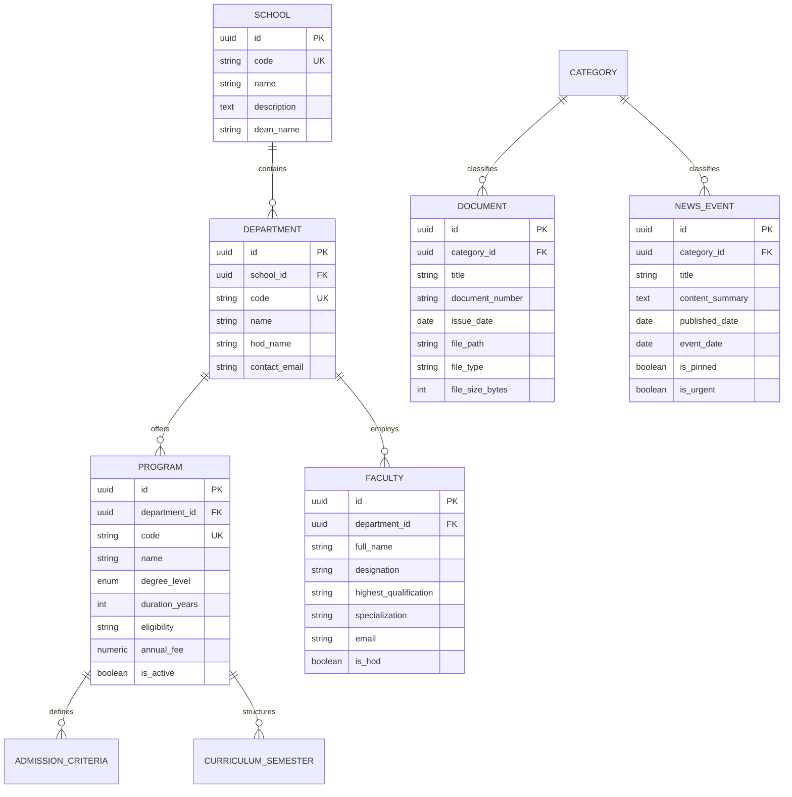

# Sai Nath University — Database & Data Domain Design

## 1. Domain Entities & Relational Schema (PostgreSQL Target)

---

## 2. Headless Static JSON Equivalents (SSG Mode)

For zero-latency GitHub Pages static hosting, domain data models are exported as strongly-typed static structures under `apps/web/src/data/`:
- `programs.ts`: Complete catalog of B.Tech, M.Tech, MBA, LL.B, B.Pharm, D.Pharm, B.Sc Nursing, Agriculture, etc.
- `schools.ts`: 7 academic schools and their constituent departments.
- `faculty.ts`: Faculty directory entries with designations, credentials, and subjects.
- `documents.ts`: Public disclosures, UGC 2(f) gazettes, BCI/PCI orders, examination notifications.
- `news.ts`: Announcements, circulars, upcoming events, academic calendar.

