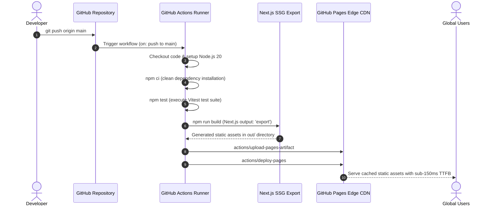

# Sai Nath University — Deployment Architecture (GitHub Actions Pages)

## 1. Automated Continuous Delivery Pipeline

The deployment pipeline is fully orchestrated via `.github/workflows/deploy.yml`.

## 2. Environment Configuration
- **Base Path Resolution:** `NEXT_PUBLIC_BASE_PATH` configured to `/univ-sainath` on GitHub Pages builds and empty `""` for local development or custom apex domain.
- **Asset Optimization:** Images unoptimized at export time (`unoptimized: true` in `next.config.js`) to guarantee compatibility with static web servers without requiring Node image resizing microservices.

