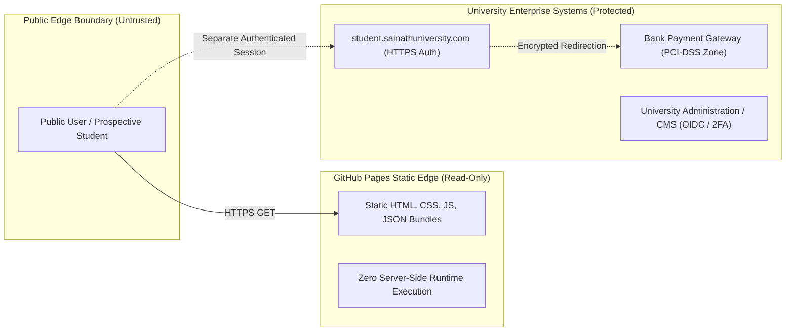

# Sai Nath University — Security & Trust Model

## 1. Trust Boundaries & Privacy Enforcement

### 1.1 Least Privilege & Data Segregation
- **Zero Student PII on Public Edge:** The public website does not store, process, or expose student personal identity numbers, examination grades, or payment credentials.
- **Form Data Validation:** Contact and admission inquiry forms validate all inputs client-side with regex and schema limits before dispatching to secure endpoints.
- **Content Security Policy (CSP):**
  - Default-src `'self'`
  - Script-src `'self' 'unsafe-inline'` (for Next.js hydration chunks)
  - Style-src `'self' 'unsafe-inline'`
  - Img-src `'self' data: https:`
  - Connect-src `'self'`
  - Frame-ancestors `'none'` (prevents clickjacking)
