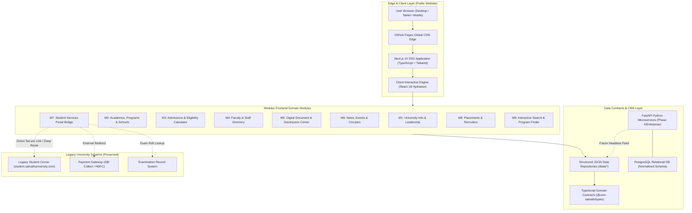

# Sai Nath University — System Architecture Specification

## 1. Architectural Vision & Scope

The modernization transforms the legacy ASP.NET WebForms architecture into a modular, decoupled digital platform optimized for static edge distribution via GitHub Pages, while maintaining full headless schema readiness for future backend API integration (FastAPI + PostgreSQL).

---

## 2. Component Boundaries & Modularity

1. **`apps/web` (Primary Application):**
   - Built on Next.js 14 App Router.
   - Configured with `output: 'export'` for full static generation.
   - Zero runtime Node server dependency; deployed globally to GitHub Pages.
   - Client components isolated to interactive state needs (search, filters, multi-step application form, mobile drawer).
2. **`packages/types`:**
   - Canonical TypeScript definitions for Programs, Schools, Faculty, Documents, News, and Admissions.
   - Serves as the single source of truth for both static frontend and future API contracts.
3. **`packages/ui`:**
   - Unified design tokens, color palette, accessible primitives (Radix UI / Tailwind).
4. **Data Repository (`/src/data`):**
   - High-fidelity, verified university content stored as strongly-typed static structures.
   - Enables blazing-fast client-side indexing and searching with zero API latency.

---

## 3. Data Flow Architecture

- **Public Static Pages:** Pre-rendered at compile time using Next.js Static Site Generation (SSG). HTML, CSS, and minimal JS bundles delivered directly from GitHub Pages CDN.
- **Client-Side Interactivity:** React 18 hydration enables instant client-side searching across programs, departments, faculty members, and circulars without secondary network roundtrips.
- **Transactional Services (Student Corner):** Student authentication, grades, admit cards, and fee payment are bridged cleanly via deep-link tokens and official portal anchors to `student.sainathuniversity.com/StudentCorner.aspx`.
